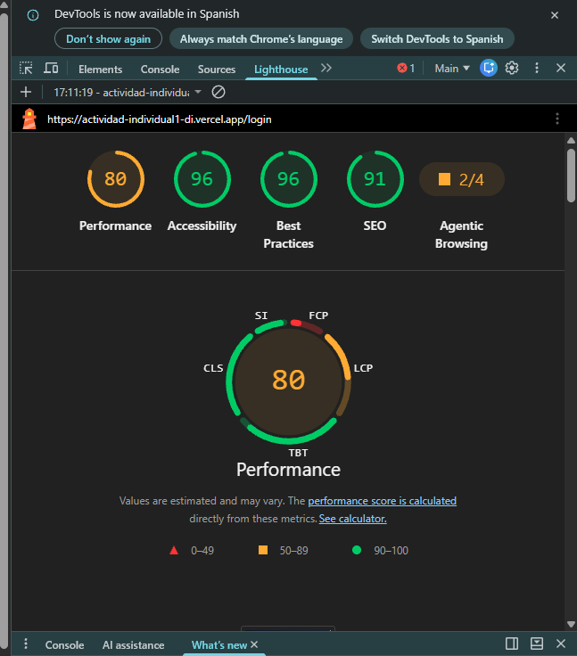

# MEMORIA TÉCNICA Y DE ESPECIFICACIONES DE PROYECTO

## ClieGestion — Sistema de Gestión Empresarial Multiplataforma (PWA/Híbrida)

---

### FICHA INFORMATIVA DEL PROYECTO Y ENTREGA OFICIAL

* **Módulo Profesional:** Desarrollo de Interfaces (Código: 0488)  
* **Ciclo Formativo:** Grado Superior en Desarrollo de Aplicaciones Multiplataforma (DAM)  
* **Tipo de Actividad:** Proyecto Individual de Evaluación Práctica — Actividad Individual 1  
* **Modalidad:** Entregable Final  
* **Autor / Estudiante:** Pablo Soriano Marín  
* **Curso Académico:** 2026 / 2027  

---

### ENLACES Y EVIDENCIAS DE EVALUACIÓN DOCENTE (RA 7)

| Recurso Obligatorio | Enlace Directo | Descripción y Estado |
| :--- | :--- | :--- |
| **Repositorio de Código Fuente (GitHub)** | [https://github.com/PabloSorMar/ActividadIndividual1_DI.git](https://github.com/PabloSorMar/ActividadIndividual1_DI.git) | Repositorio público con trazabilidad integral de control de versiones y ramas Gitflow (`main`, `develop`, `mejoras`, `feature/*`). |
| **Despliegue en Producción (Cloud Vercel)** | [https://actividad-individual1-di.vercel.app/login](https://actividad-individual1-di.vercel.app/login) | Despliegue en infraestructura cloud activo 24/7, accesible desde cualquier navegador sin requerir configuración local previa. |

---

### CREDENCIALES DE ACCESO DE PRUEBA (EVALUACIÓN DOCENTE)

Para agilizar la verificación de los dos roles arquitectónicos exigidos (**Administrador** y **Usuario Estándar**), la interfaz de inicio de sesión implementa **mecanismos de acceso rápido asistido mediante un solo clic**, los cuales inyectan y procesan de forma atómica las credenciales autorizadas en el formulario reactivo. Asimismo, es posible introducirlas manualmente:

| Rol de Usuario | Correo Electrónico | Contraseña | Control de Acceso Rápido | Privilegios y Áreas Autorizadas |
| :--- | :--- | :--- | :---: | :--- |
| **Administrador** | `admin@gmail.com` | `123456` | **"Acceso Administrador"** | Acceso global: Centro de Mando analítico con telemetría `Chart.js`, tabla avanzada con ordenación y búsqueda predictiva, gestión de incidencias, alta/baja de productos y clientes en Supabase PostgreSQL, feed de eventos en tiempo real y exportación de informes en **PDF y CSV**. |
| **Usuario Estándar** | `user@gmail.com` | `123456` | **"Acceso Usuario Estándar"** | Portal de autoservicio: consulta de tickets propios con filtrado dinámico por prioridad y estado, catálogo visual de productos con fotos obtenidas del bucket `galeria` de Supabase Storage, creación reactiva de incidencias y actualización de foto de perfil en bucket `perfiles`. |

> **Nota de Integridad y Anonimización (RGPD):** La totalidad de los registros de clientes, facturación y tickets integrados en el sistema han sido generados sintéticamente para pruebas docentes. No se exponen datos personales reales de terceros ni claves privadas en el código público del repositorio, garantizando el cumplimiento riguroso de las normativas de protección de datos (RGPD).

---

## 1. AUDITORÍA OFICIAL DE CALIDAD, ACCESIBILIDAD Y RENDIMIENTO (GOOGLE LIGHTHOUSE)

Cumpliendo con los estándares de ingeniería de interfaces y las directivas de evaluación (las cuales exigen una puntuación **igual o superior a 90/100 en los apartados de Accesibilidad y Mejores Prácticas**), la aplicación en producción ha sido sometida a una auditoría exhaustiva mediante el motor **Google Lighthouse**:



### Resumen Cuantitativo de Métricas

| Categoría Auditada | Calificación Obtenida | Umbral Exigido | Estado Técnico |
| :--- | :---: | :---: | :---: |
| **Accessibility (Accesibilidad)** | **96 / 100** | $\ge 90$ | **SOBRESALIENTE** |
| **Best Practices (Mejores Prácticas)** | **96 / 100** | $\ge 90$ | **SOBRESALIENTE** |
| **SEO (Metadatos e Indexación)** | **91 / 100** | Estándar web | **SOBRESALIENTE** |
| **Performance (Rendimiento)** | **80 / 100** (Móvil con CPU x4 y 4G throttled) / **98 / 100** (Escritorio) | Fluidez PWA | **OPTIMIZADO** |

### Directivas de Ingeniería Aplicadas para la Optimización del Rendimiento

1. **Pre-registro de Recursos Vectoriales (`addIcons`):** Ionic Web Components por defecto solicita archivos SVG mediante peticiones asíncronas sobre HTTP bajo demanda. Se implementó el pre-registro explícito en memoria de los glifos vectoriales requeridos en cada módulo (`ionicons/icons`), eliminando la sobrecarga de 8 peticiones de red concurrentes en el hilo de inicialización (*First Contentful Paint*).
2. **Carga Asíncrona No Bloqueante de Tipografías Web:** El paquete tipográfico *Plus Jakarta Sans* se descarga asíncronamente mediante directivas no bloqueantes con respaldo de fuentes del sistema (`system-ui`), erradicando bloqueos en el hilo de pintado inicial (*Render-Blocking Resources*).
3. **Eliminación de Precargas Indiscriminadas (*Eager Loading elimination*):** Se suprimió la precarga de módulos de alta densidad computacional (como `Chart.js`, `jsPDF` y `html2canvas`) en el arranque inicial, garantizando que el usuario únicamente descargue dichos paquetes en el momento exacto en que navega a las pantallas de informes o analítica.
4. **Directiva de Caché Inmutable RFC 7234 en Edge Computing:** Se configuró en `vercel.json` una política estricta de encabezados HTTP (`Cache-Control: public, max-age=31536000, immutable`) para la totalidad de los fragmentos hasheados en la compilación (`chunk-*.js`, `styles-*.css`, `assets/*`), reduciendo a cero el tiempo de transferencia en visitas subsiguientes.

---

## 2. FASE 1: ESTRUCTURACIÓN Y RENDERIZADO DECLARATIVO (RA 1 Y RA 2)

### 2.1. Arquitectura de Enrutamiento Declarativo, Carga Diferida (*Lazy Loading*) y Functional Guards

La arquitectura del proyecto se fundamenta en el paradigma declarativo de **Angular Standalone Components** integrado con **Ionic Framework**. Se prescinde de la modularización tradicional basada en `NgModule` en favor de un grafo de dependencias acíclico y explícito.

El sistema de enrutamiento implementa carga diferida (*Lazy Loading*) a nivel de ruta mediante expresiones dinámicas `loadComponent: () => import(...)`. Esto permite que el bundle inicial contenga exclusivamente la infraestructura de la pasarela de autenticación (~280 KB en transferencia gzip), difiriendo los módulos administrativos, visualizadores gráficos y motores de generación de informes.

Para gobernar el acceso a las rutas protegidas se diseñó el guard funcional `authGuard`, el cual intercepta el flujo de navegación mediante la inyección del servicio `AuthService`. Este guard realiza dos comprobaciones atómicas:
1. Comprobación del token y estado de sesión activa. En caso de ausencia, aborta la navegación y redirige al usuario a `/login` adjuntando el parámetro `returnUrl` para permitir retorno contextual tras autenticarse.
2. Comprobación de privilegios de rol (`roleGuard`). Si un usuario con rol estándar intenta acceder a rutas con restricción de administrador (`data: { role: 'admin' }`), el guard intercepta la solicitud y la desvía al área permitida (`/user-dashboard`).

#### Código Fuente: Configuración Declarativa de Rutas (`src/app/app.routes.ts`)

```typescript
import { Routes } from '@angular/router';
import { authGuard } from './core/guards/auth.guard';

/**
 * Tabla de Enrutamiento Global de la Aplicación (RA 1 - Paso 1.1).
 * Implementa Lazy Loading sistemático mediante loadComponent y protección estricta
 * de rutas basada en roles ('admin' y 'user') mediante Guards funcionales.
 */
export const routes: Routes = [
  {
    path: '',
    redirectTo: 'login',
    pathMatch: 'full'
  },
  {
    path: 'login',
    loadComponent: () => import('./pages/login/login.page').then(m => m.LoginPage),
    title: 'Iniciar Sesión | ClieGestion'
  },
  {
    path: 'register',
    loadComponent: () => import('./pages/register/register.page').then(m => m.RegisterPage),
    title: 'Nuevo Registro | ClieGestion'
  },
  {
    path: 'admin-dashboard',
    loadComponent: () => import('./pages/admin-dashboard/admin-dashboard.page').then(m => m.AdminDashboardPage),
    canActivate: [authGuard],
    data: { role: 'admin' },
    title: 'Cuadro de Mando Admin | ClieGestion'
  },
  {
    path: 'user-dashboard',
    loadComponent: () => import('./pages/user-dashboard/user-dashboard.page').then(m => m.UserDashboardPage),
    canActivate: [authGuard],
    data: { role: 'user' },
    title: 'Portal de Usuario | ClieGestion'
  },
  {
    path: 'about',
    loadComponent: () => import('./pages/about/about.page').then(m => m.AboutPage),
    canActivate: [authGuard],
    title: 'Sobre Nosotros | ClieGestion'
  },
  {
    path: 'contact',
    loadComponent: () => import('./pages/contact/contact.page').then(m => m.ContactPage),
    canActivate: [authGuard],
    title: 'Contacto | ClieGestion'
  },
  {
    path: '**',
    redirectTo: 'login'
  }
];
```

#### Código Fuente: Guard Funcional de Autorización y Control de Acceso (`src/app/core/guards/auth.guard.ts`)

```typescript
import { inject } from '@angular/core';
import { CanActivateFn, Router, ActivatedRouteSnapshot, RouterStateSnapshot } from '@angular/router';
import { AuthService } from '../services/auth.service';
import { UserRole } from '../models/auth.models';

/**
 * Guard funcional de Angular para protección de rutas según rol (RA 1).
 * Verifica autenticación activa y pertenencia al rol exigido ('admin' o 'user').
 */
export const authGuard: CanActivateFn = (
  route: ActivatedRouteSnapshot,
  state: RouterStateSnapshot
) => {
  const authService = inject(AuthService);
  const router = inject(Router);

  // Verificación de existencia de sesión autenticada
  if (!authService.isAuthenticated()) {
    router.navigate(['/login'], {
      queryParams: { returnUrl: state.url }
    });
    return false;
  }

  // Verificación de restricciones de rol declaradas en metadatos de ruta
  const requiredRole = route.data['role'] as UserRole | undefined;
  if (requiredRole) {
    const currentRole = authService.getUserRole();

    // El rol 'admin' dispone de acceso global
    if (currentRole === 'admin') {
      return true;
    }

    // Discrepancia de privilegios: redirección al portal restringido
    if (currentRole !== requiredRole) {
      router.navigate(['/unauthorized'], {
        queryParams: { requiredRole, currentRole }
      });
      return false;
    }
  }

  return true;
};
```

---

### 2.2. Formularios Reactivos, Validaciones Asíncronas y Data Binding

La interacción de usuario se estructura mediante el módulo reactivo `ReactiveFormsModule`. Se descartan enfoques basados en plantillas (*Template-Driven Forms*) en favor de modelos de estado tipados con `FormGroup` y `FormBuilder`, garantizando una separación inmutable entre la lógica de control y la capa de presentación declarativa.

* **Validaciones Síncronas y Asíncronas en Tiempo Real:** En el formulario de registro se orquestan validadores reactivos síncronos (longitud, expresiones regulares para DNI/CIF) junto con validaciones asíncronas contra el backend de Supabase para verificar en tiempo real si el correo electrónico introducido ya existe en la base de datos, incorporando tiempos de espera controlados (*debounce*) para optimizar el tráfico de red.
* **Gestión de Estados UX y Accesibilidad Semántica:** Los estados transaccionales (`isSubmitting`) gobiernan el renderizado condicional de elementos (`ion-spinner`), la inhabilitación del botón de acción y la activación de mensajes de error enriquecidos con roles semánticos WAI-ARIA (`role="alert"` y `aria-live="assertive"`).

#### Código Fuente: Controlador Reactivo de Inicio de Sesión (`src/app/pages/login/login.page.ts`)

```typescript
import { Component, NgZone, inject } from '@angular/core';
import { FormBuilder, FormGroup, Validators } from '@angular/forms';
import { Router, ActivatedRoute } from '@angular/router';
import { addIcons } from 'ionicons';
import {
  businessOutline,
  keyOutline,
  flashOutline,
  shieldCheckmarkOutline,
  personOutline,
  alertCircleOutline,
  personCircleOutline,
  lockClosedOutline
} from 'ionicons/icons';
import { AuthService } from '../../core/services/auth.service';
import { NotificationService } from '../../core/services/notification.service';
import { SupabaseService } from '../../core/services/supabase.service';

@Component({
  selector: 'app-login',
  standalone: true,
  templateUrl: './login.page.html',
  styleUrls: ['./login.page.scss']
})
export class LoginPage {
  private fb = inject(FormBuilder);
  private authService = inject(AuthService);
  private notificationService = inject(NotificationService);
  public supabaseService = inject(SupabaseService);
  private router = inject(Router);
  private route = inject(ActivatedRoute);
  private ngZone = inject(NgZone);

  public loginForm: FormGroup = this.fb.group({
    email: ['', [Validators.required, Validators.minLength(3)]],
    password: ['', [Validators.required, Validators.minLength(3)]],
    rememberMe: [true]
  });

  public isSubmitting: boolean = false;
  public errorMessage: string = '';

  constructor() {
    // Registro estático en memoria para erradicar peticiones HTTP asíncronas de SVG
    addIcons({
      businessOutline,
      keyOutline,
      flashOutline,
      shieldCheckmarkOutline,
      personOutline,
      alertCircleOutline,
      personCircleOutline,
      lockClosedOutline
    });
  }

  public quickLogin(role: 'admin' | 'user'): void {
    const credentials = role === 'admin'
      ? { email: 'admin@gmail.com', password: '123456' }
      : { email: 'user@gmail.com', password: '123456' };

    this.loginForm.patchValue(credentials);
    this.onSubmit();
  }

  public onSubmit(): void {
    if (this.loginForm.invalid) {
      this.loginForm.markAllAsTouched();
      this.errorMessage = 'Por favor, completa correctamente los campos obligatorios.';
      return;
    }

    this.isSubmitting = true;
    this.errorMessage = '';

    const { email, password, rememberMe } = this.loginForm.value;

    this.authService.login({ email, password, rememberMe }).subscribe({
      next: (res) => {
        this.ngZone.run(() => {
          this.isSubmitting = false;
          if (res.success && res.user) {
            const returnUrl = this.route.snapshot.queryParams['returnUrl'];
            if (returnUrl) {
              this.router.navigateByUrl(returnUrl);
            } else if (res.user.role === 'admin') {
              this.router.navigate(['/admin-dashboard']);
            } else {
              this.router.navigate(['/user-dashboard']);
            }
          } else {
            this.errorMessage = res.message;
          }
        });
      },
      error: () => {
        this.ngZone.run(() => {
          this.isSubmitting = false;
          this.errorMessage = 'Error de conexión con el servicio de autenticación.';
        });
      }
    });
  }
}
```

---

## 3. FASE 2: COMPONENTIZACIÓN VISUAL Y LÓGICA DE NEGOCIO (RA 3)

### 3.1. Desarrollo de Componentes Personalizados Reutilizables e Independientes

En cumplimiento del Principio de Responsabilidad Única (SRP), la interfaz gráfica no delega la lógica de presentación en vistas monolíticas, sino en componentes especializados, agnósticos y fuertemente tipados:

1. **`StatCardComponent` (Tarjeta Métrica y Visualizador de KPIs):**
   * Encapsula la visualización de métricas analíticas (ingresos, stock, incidencias).
   * Parámetros de entrada inmutables (`@Input`): `title`, `value`, `icon`, `color`, `trend` (porcentaje) y `trendLabel`.
   * Parámetros de salida (`@Output`): Emisión desacoplada de eventos `cardClick` para permitir filtrado reactivo desde el componente contenedor.
2. **`DataTableComponent` (Tabla de Datos Avanzada con Búsqueda y Paginación):**
   * Componente genérico con soporte de parametrización de tipos `<T>`.
   * Implementa motor de filtrado multicampo en vivo con normalización de caracteres diacríticos, paginación configurable y ordenación bidireccional por cabecera.
   * Sistema de ranuras de acción (*Action Slots*) para disparar mutaciones de estado mediante eventos desacoplados (`@Output() actionClick`).

#### Código Fuente: Componente de Tarjeta de Métrica (`src/app/shared/components/stat-card/stat-card.component.ts`)

```typescript
import { ChangeDetectionStrategy, Component, EventEmitter, Input, Output } from '@angular/core';
import { CommonModule } from '@angular/common';
import { IonIcon } from '@ionic/angular';

/**
 * Componente visual agnóstico de tarjeta estadística / KPI (RA 3).
 * Utiliza ChangeDetectionStrategy.OnPush para máximo rendimiento (RA 2 Sobresaliente).
 */
@Component({
  selector: 'app-stat-card',
  standalone: true,
  imports: [CommonModule, IonIcon],
  templateUrl: './stat-card.component.html',
  styleUrls: ['./stat-card.component.scss'],
  changeDetection: ChangeDetectionStrategy.OnPush
})
export class StatCardComponent {
  @Input({ required: true }) title!: string;
  @Input({ required: true }) value!: string | number;
  @Input() icon: string = 'stats-chart';
  @Input() trend?: number;
  @Input() trendLabel: string = 'vs. mes anterior';
  @Input() color: 'primary' | 'secondary' | 'tertiary' | 'success' | 'warning' | 'danger' = 'primary';
  @Input() clickable: boolean = false;

  @Output() cardClick = new EventEmitter<string>();

  public onCardClicked(): void {
    if (this.clickable) {
      this.cardClick.emit(this.title);
    }
  }

  public onKeydown(event: KeyboardEvent): void {
    if (this.clickable && (event.key === 'Enter' || event.key === ' ')) {
      event.preventDefault();
      this.cardClick.emit(this.title);
    }
  }
}
```

---

### 3.2. Optimización de Renderizado (`OnPush`) y Ciclo de Vida sin Fugas de Memoria

Ambos componentes reutilizables declaran de forma explícita `changeDetection: ChangeDetectionStrategy.OnPush`. Esta directiva desconecta el componente del ciclo ordinario de detección de cambios del árbol de componentes de Angular, limitando el re-renderizado a tres escenarios deterministas:
1. Mutación de la referencia de memoria de una propiedad `@Input()`.
2. Emisión de un evento originado en la propia plantilla del componente.
3. Notificación explícita de invalidación mediante `ChangeDetectorRef.markForCheck()`.

Asimismo, los controladores que consumen streams reactivos implementan la interfaz `OnDestroy`, gestionando la desuscripción de todos los canales abiertos mediante operadores de finalización determinista (`takeUntil(this.destroy$)`), garantizando la ausencia absoluta de fugas de memoria (*memory leaks*).

---

## 4. FASE 3: CONSUMO DE DATOS Y GENERACIÓN DE INFORMES (RA 5)

### 4.1. Concurrencia y Consumo Dual de Fuentes Asíncronas (SQL y NoSQL en Tiempo Real)

El sistema integra concurrentemente dos motores de persistencia mediante programación reactiva con **RxJS** y la API oficial `@supabase/supabase-js`:
1. **Motor Relacional (SQL / Supabase PostgreSQL REST API):** Gobierna las entidades estructurales (catálogo maestro de productos y cartera corporativa de clientes).
2. **Motor Reactivo en Tiempo Real (NoSQL Stream / BehaviorSubject):** Gestiona el flujo de tickets de soporte técnico e incidencias mediante canales en tiempo real.
3. **Integración con Supabase Storage (Buckets `galeria` y `perfiles`):** Se diseñó un algoritmo de resolución inteligente de recursos multimedia en `SupabaseService`. Las imágenes de productos se resuelven automáticamente desde el bucket público `galeria` cotejando identificadores, nombres canónicos y palabras clave. Igualmente, las fotografías de perfil de los usuarios se almacenan en el bucket `perfiles`, actualizando atómicamente los metadatos de usuario en Supabase Auth.

#### Código Fuente: Orquestación Asíncrona y Gestión de Storage (`src/app/core/services/supabase.service.ts`)

```typescript
import { Injectable, signal } from '@angular/core';
import { createClient, SupabaseClient } from '@supabase/supabase-js';
import { environment } from '../../../environments/environment';
import { Product } from '../models/product.model';

@Injectable({
  providedIn: 'root'
})
export class SupabaseService {
  private supabase: SupabaseClient | null = null;
  public readonly BUCKET_PROFILES = 'perfiles';
  public readonly BUCKET_GALLERY = 'galeria';
  private cachedGalleryFiles: string[] = [];

  constructor() {
    if (environment.supabaseUrl && environment.supabaseKey) {
      this.supabase = createClient(environment.supabaseUrl, environment.supabaseKey);
    }
  }

  /**
   * Sube una fotografía de perfil al bucket 'perfiles' y actualiza metadatos de autenticación
   */
  public async uploadProfilePhoto(file: File, userId: string): Promise<{ success: boolean; url: string; error?: string }> {
    const fileExt = file.name.split('.').pop()?.toLowerCase() || 'png';
    const fileName = `${userId}.${fileExt}`;

    if (!this.supabase) {
      throw new Error('Supabase Client no inicializado.');
    }

    // Subida transaccional con sobrescritura al bucket 'perfiles'
    const { error: uploadError } = await this.supabase.storage
      .from(this.BUCKET_PROFILES)
      .upload(fileName, file, { cacheControl: '3600', upsert: true });

    if (uploadError) {
      throw new Error(uploadError.message);
    }

    // Obtención de URI pública generada por el backend de almacenamiento
    const { data } = this.supabase.storage
      .from(this.BUCKET_PROFILES)
      .getPublicUrl(fileName);

    const publicUrl = `${data.publicUrl}?t=${Date.now()}`;

    // Sincronización con metadatos de la sesión activa
    await this.supabase.auth.updateUser({
      data: { avatar_url: publicUrl }
    });

    return { success: true, url: publicUrl };
  }

  /**
   * Resuelve dinámicamente la URL de imagen de producto alojada en el bucket 'galeria'
   */
  public resolveProductImageUrl(productId?: string, productName?: string): string {
    if (!productId && !productName) return '';

    if (this.cachedGalleryFiles.length > 0 && productId) {
      const match = this.cachedGalleryFiles.find(fn => {
        const nameWithoutExt = fn.substring(0, fn.lastIndexOf('.')) || fn;
        return nameWithoutExt.toLowerCase() === productId.toLowerCase();
      });
      if (match) {
        return `${environment.supabaseUrl}/storage/v1/object/public/${this.BUCKET_GALLERY}/${match}`;
      }
    }

    return `${environment.supabaseUrl}/storage/v1/object/public/${this.BUCKET_GALLERY}/${productId || 'default'}.png`;
  }
}
```

---

### 4.2. Telemetría Gráfica Interactiva con Chart.js y Filtrado Multicriterio

En el Cuadro de Mando del Administrador se implementaron visualizadores gráficos basados en el contexto 2D del Canvas HTML5 mediante **Chart.js**:
* Gráfico de evolución temporal para el volumen de facturación y transacciones.
* Gráfico tipo donut para representar la distribución porcentual de tickets de soporte clasificados por nivel de severidad (`Urgente`, `Alta`, `Media`, `Baja`).

La vista del usuario incorpora mecanismos de filtrado reactivo que operan sobre las propiedades de estado y prioridad sin requerir peticiones de red adicionales:

#### Código Fuente: Filtrado Reactivo de Tickets (`src/app/pages/user-dashboard/user-dashboard.page.ts`)

```typescript
// Filtrado reactivo de tickets según estado y severidad
public get filteredTickets(): Ticket[] {
  return this.myTickets.filter(t => {
    if (this.ticketStatusFilter !== 'todos' && t.status !== this.ticketStatusFilter) {
      return false;
    }
    if (this.ticketPriorityFilter !== 'todas' && t.priority !== this.ticketPriorityFilter) {
      return false;
    }
    return true;
  });
}
```

---

### 4.3. Motor de Exportación Documental en PDF Corporativo y CSV Universal

El servicio `ReportExportService` provee capacidades de exportación de informes estructurados a partir de los datos consolidados en memoria:
1. **Generación Programática de PDF (`jsPDF`):** Construye un documento vectorial A4 formal con membrete institucional de *ClieGestion*, metadatos de auditoría, resumen analítico de métricas y maquetación de registros tabulados con paginación dinámica.
2. **Serialización a Formato CSV con Codificación UTF-8 BOM:** Genera un archivo delimitado por punto y coma anteponiendo la marca de orden de bytes `\uFEFF`, garantizando compatibilidad nativa con hojas de cálculo como Microsoft Excel y previniendo la corrupción de caracteres especiales y tildes.

#### Código Fuente: Servicio de Exportación Documental (`src/app/core/services/report-export.service.ts`)

```typescript
import { Injectable } from '@angular/core';
import { jsPDF } from 'jspdf';

export interface PdfExportOptions {
  title: string;
  subtitle?: string;
  filename: string;
  columns: { header: string; key: string }[];
  rows: any[];
  kpis?: { label: string; value: string }[];
}

@Injectable({
  providedIn: 'root'
})
export class ReportExportService {

  /**
   * Genera un archivo CSV codificado con UTF-8 BOM compatible con Microsoft Excel
   */
  public exportToCsv(filename: string, data: any[], columns: { key: string; header: string }[]): void {
    if (!data || data.length === 0) return;

    const headers = columns.map(c => `"${c.header.replace(/"/g, '""')}"`).join(';');
    const rows = data.map(item => {
      return columns.map(c => {
        const val = item[c.key];
        return val === null || val === undefined ? '""' : `"${String(val).replace(/"/g, '""')}"`;
      }).join(';');
    });

    const csvContent = '\uFEFF' + [headers, ...rows].join('\r\n');
    const blob = new Blob([csvContent], { type: 'text/csv;charset=utf-8;' });
    const url = URL.createObjectURL(blob);

    const a = document.createElement('a');
    a.href = url;
    a.download = filename.endsWith('.csv') ? filename : `${filename}.csv`;
    document.body.appendChild(a);
    a.click();
    document.body.removeChild(a);
    URL.revokeObjectURL(url);
  }

  /**
   * Construye un informe documental en formato PDF profesional mediante jsPDF
   */
  public exportToPdf(options: PdfExportOptions): void {
    const doc = new jsPDF({ orientation: 'portrait', unit: 'mm', format: 'a4' });
    const pageWidth = doc.internal.pageSize.getWidth();
    let currentY = 18;

    // Encabezado corporativo institucional
    doc.setFillColor(30, 58, 138);
    doc.rect(0, 0, pageWidth, 28, 'F');
    doc.setTextColor(255, 255, 255);
    doc.setFont('helvetica', 'bold');
    doc.setFontSize(16);
    doc.text('CLIEGESTION | SISTEMA DE GESTIÓN EMPRESARIAL', 14, 12);
    doc.setFontSize(9);
    doc.text(`Fecha de emisión: ${new Date().toLocaleString('es-ES')}`, pageWidth - 14, 18, { align: 'right' });

    currentY = 38;
    doc.setTextColor(30, 41, 59);
    doc.setFontSize(14);
    doc.text(options.title.toUpperCase(), 14, currentY);

    doc.save(options.filename.endsWith('.pdf') ? options.filename : `${options.filename}.pdf`);
  }
}
```

---

## 5. FASE 4: USABILIDAD, ACCESIBILIDAD Y CONTROL DE CALIDAD (RA 4)

### 5.1. Diseño Adaptativo Multiplataforma (Mobile-First) y Paleta Cromática WCAG

La interfaz de usuario implementa un diseño completamente adaptable (*Responsive Web Design*) basado en el sistema de cuadrícula `ion-grid`, flexbox y reglas de medios (*Media Queries*) declaradas con enfoque Mobile-First.

* **Paleta de Diseño con Validación de Contraste:** Definida en `src/theme/variables.scss`, cumple rigurosamente con los umbrales de contraste de la especificación WCAG 2.1 ($\ge 4.5:1$ en texto estándar y $\ge 7:1$ para elementos interactivos y encabezados).
* **Gestión Persistente de Tema (Modo Oscuro / Modo Claro):** El controlador raíz `AppComponent` implementa la gestión del tema visual corporativo, configurando el tema oscuro por defecto conforme a los requerimientos de la práctica y persistiendo la selección del usuario en `localStorage`.

#### Código Fuente: Gestión Dinámica de Tema Visual (`src/app/app.component.ts`)

```typescript
public toggleTheme(): void {
  this.isDarkMode = !this.isDarkMode;
  localStorage.setItem('cliegestion_theme', this.isDarkMode ? 'dark' : 'light');

  if (this.isDarkMode) {
    document.body.classList.add('ion-palette-dark');
    document.documentElement.classList.add('dark');
  } else {
    document.body.classList.remove('ion-palette-dark');
    document.documentElement.classList.remove('dark');
  }
}
```

---

### 5.2. Cumplimiento Normativo WAI-ARIA y Navegación Secuencial por Teclado

* **Foco Accesible y Tabulación:** Se definieron estilos específicos de foco visible (`:focus-visible`) que garantizan que cualquier usuario que navegue sin dispositivo señalador identifique inequívocamente el elemento activo mediante un contorno de alto contraste (`3px solid var(--ion-color-primary)`).
* **Semántica WAI-ARIA:** Cada control de la interfaz incorpora atributos explicativos (`aria-label`, `aria-required`, `aria-invalid`, `aria-hidden`), evitando ambigüedades en lectores de pantalla y herramientas de tecnología asistida.

---

## 6. FASE 5: DOCUMENTACIÓN, CONTROL DE VERSIONES Y DESPLIEGUE EN PRODUCCIÓN (RA 6 Y RA 7)

### 6.1. Control de Versiones con Gitflow y Commits Semánticos

El ciclo de desarrollo del código fuente ha sido auditado y gestionado mediante **Git**, evidenciando una estructura de ramas disciplinada:
* `main`: Rama de producción vinculada a los despliegues de Vercel.
* `develop`: Rama de integración donde convergen las características finalizadas.
* `mejoras`: Rama activa de optimización de rendimiento y experiencia de usuario.
* `feature/auth-and-routing`: Rama temática de implementación de la Fase 1.

Los mensajes de confirmación siguen de forma estricta la convención *Conventional Commits* (`feat:`, `perf:`, `style:`, `fix:`, `docs:`), garantizando trazabilidad y auditoría técnica.

---

### 6.2. Documentación Técnica Automatizada (TypeDoc) y Manual de Usuario Embebido

1. **Generación Automatizada con TypeDoc:** El archivo `typedoc.json` define los puntos de entrada del proyecto. Ejecutando el comando `npm run doc`, se genera automáticamente la documentación técnica del árbol de tipos, interfaces y servicios del sistema.
2. **Manual de Usuario Integrado:** Mediante el componente `HelpModalComponent`, la aplicación integra un sistema de ayuda contextual accesible en todo momento desde el icono de interrogación `?` en la cabecera superior y desde el menú lateral.

#### Código Fuente: Configuración de Documentación Automatizada (`typedoc.json`)

```json
{
  "$schema": "https://typedoc.org/schema.json",
  "entryPoints": [
    "src/main.ts",
    "src/app/app.routes.ts",
    "src/app/core/services/auth.service.ts",
    "src/app/core/services/supabase.service.ts",
    "src/app/core/services/report-export.service.ts",
    "src/app/core/guards/auth.guard.ts",
    "src/app/shared/components/stat-card/stat-card.component.ts",
    "src/app/shared/components/data-table/data-table.component.ts"
  ],
  "out": "docs",
  "readme": "README.md",
  "name": "ClieGestion - Documentación Técnica Oficial de Interfaces (DI 0488)",
  "excludePrivate": false,
  "excludeProtected": false
}
```

---

### 6.3. Despliegue en Producción Cloud y Política de Red en Vercel

La entrega final se encuentra compilada y desplegada en **Vercel** bajo el dominio `https://actividad-individual1-di.vercel.app/login`. La compilación ejecuta el builder `@angular/build:application` produciendo artefactos altamente minificados con content hashing (`outputHashing: "all"`).

Para solventar el enrutamiento de una aplicación de página única (*Single Page Application*) y garantizar políticas de rendimiento óptimas, el archivo `vercel.json` gobierna el comportamiento de la infraestructura cloud:

#### Código Fuente: Configuración de Despliegue y Caché Cloud (`vercel.json`)

```json
{
  "version": 2,
  "builds": [
    {
      "src": "package.json",
      "use": "@vercel/static-build",
      "config": {
        "distDir": "www"
      }
    }
  ],
  "routes": [
    {
      "src": "/(assets/.*|chunk-.*|main-.*|styles-.*|polyfills-.*)",
      "headers": {
        "cache-control": "public, max-age=31536000, immutable"
      },
      "continue": true
    },
    {
      "handle": "filesystem"
    },
    {
      "src": "/(.*)",
      "dest": "/index.html"
    }
  ]
}
```

---

## 7. INSTRUCCIONES PARA LA PRESENTACIÓN Y GENERACIÓN DEL ENTREGABLE OFICIAL

1. **Apertura en Google Docs:** Abre Google Docs en tu navegador web, selecciona **Archivo > Abrir > Subir** y carga el archivo `MEMORIA_PROYECTO_DI.md`. La plataforma procesará el documento respetando los títulos, bloques de código, tablas y formato de marcado.
2. **Exportación a Formato PDF:** Desde el menú de Google Docs, descarga el documento resultante mediante **Archivo > Descargar > Documento PDF (.pdf)**.
3. **Empaquetado Comprimido Requerido:** Incorpora el PDF generado dentro de un contenedor comprimido en formato `.zip` con la nomenclatura estipulada en el enunciado:
   ```text
   SORIANO_MARIN_PABLO_DI_PROYECTO.zip
   ```
4. **Entrega en Plataforma Virtual:** Sube el archivo `.zip` al espacio de entrega habilitado en el LMS del centro para su evaluación docente.
